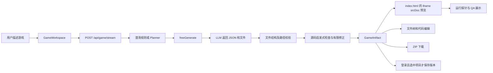
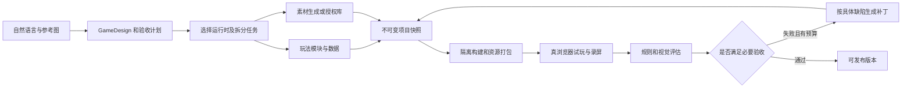

# ARCANE 项目审查与优化路线

审查日期：2026-10-09。竞品资料以本次读取的官方页面为依据；功能公告、内测能力与已完成的本地验证分别标注。本次没有修改业务代码，也没有调用真实计费模型或外部存储。

**判断：ARCANE 已经有 AI 游戏创作工作台的外形和部分流水线，但生成、编辑、预览、保存、验收尚未形成可靠闭环。最有价值的下一步，是把它做成能持续修改、真实验证、稳定保存和直接分享的浏览器游戏创作产品。**

## 1. 阅读范围与证据边界

已逐文件完整阅读 `client/`、`server/`、`shared/`、`drizzle/`、`tools/`、`spec/`、`demo/`、`dave-clone/`：共 **147 个文件、22,341 行**，包含全部业务源码、公共脚本、53 个 UI 组件、测试、迁移、游戏引擎和示例。还读了根目录配置、模板清单、项目记录和两份 GameFactory 分析文档。

连同配置、文档和历史研究，共完整阅读 **175 个文件、24,038 行**。完整清单见 [阅读覆盖记录](./阅读覆盖记录.json)，每个文件附行数、字节数与 SHA-256，核心目录没有未读文件。详细附件：[前端](./前端详细审查.md)、[后端](./后端详细审查.md)、[游戏流水线](./游戏流水线详细审查.md)。

`node_modules/` 是依赖，`dist/` 是旧构建产物，锁文件和临时请求日志属于依赖／历史产物，`_tmp_tests/GF3A/` 是另一个第三方项目。这些没有计入“ARCANE 每行源码完整阅读”的范围；GF3A 只核对了相关架构与验收文档。没有逐行审计全部第三方依赖和 GF3A 的十几万行实现，也没有读取或披露 `.env` 凭据。不能把本次审查称为全部依赖安全审计。

前端部分结论来自完整源码和调用关系，尚未以真实浏览器逐项操作复现；生成、代理、JWT 等部分使用隔离 mock 验证；类型检查、现有测试、冒烟测试和生产构建实际执行过。没有实测竞品付费账户内的生成质量、成本、速度或成功率，因此下面不做虚构排名。

## 2. 项目到底由什么组成

### 2.1 当前网页使用的主路径

自然语言修改走 `freePatch`：把当前文件集和修改请求发送给模型，接受它返回的文件，再按路径合并。当前 UI 使用普通 tRPC fetch，生成与修改没有共用一个完整任务协议。

重要事实：所谓 Planner 在有关键词的请求上，往往只是把原请求截取后包装成一句“创作一个基于……的游戏”，没有输出可验证的玩法设计。模型生成受约 8,000 输出 token 和“index.html 约 350 行”的提示约束；实际主路径主要面向原生 JS + Canvas 的小型 HTML 游戏。

### 2.2 保留但没有进入当前主界面的另一条路径

`agentService.ts → GameSpec → gamespec/gates/corrector → compiler → buildAdapter` 是旧的结构化模板管线，支持 flappy、shooter、runner、journey。它有类型、规格归一化和有界修正，值得保留其工程思想，但旧 genre 枚举和默认模板不适合作为任意游戏创作的上限。

`journeyData.ts` 把事件、委托、奇遇、结局与引擎分离，这是可以复用的内容建模方向。`journeyEngine.ts` 是大段 JS 字符串，当前有语法错误；TypeScript 并不会解析其中的游戏 JS。

完整阅读还发现：新增的 21 个委托、7 个奇遇已有数据，当前引擎没有真正执行这些数据；独立 schema 文件与运行时 schema 对 quests/secrets 的支持不一致。`journeyProject` 输出外置 data 和 engine 文件，却在 index 内联另一份，README 所说“只编辑 data.json 即改变玩法”并不成立。这些应视为未完成的集成，而非已有功能。

### 2.3 平台和实验不能混为一谈

| 部分 | 当前用途 | 不应由文件存在推导出的能力 |
|---|---|---|
| React/Vite/Monaco 工作台 | 对话、代码、预览、QA | 不等于完整游戏编辑器或可靠 IDE |
| Express/tRPC/Manus OAuth | API 和登录基础 | 不等于完整任务、配额、计费、组织权限体系 |
| MySQL/Drizzle + 对象存储接口 | 项目、版本、源码、日志 | 不等于原子保存、可恢复历史或公开托管 |
| sourceGates/runtimeProbe | 轻量检查和短时观察 | 不等于真实通关、规则正确或好玩 |
| demo/pseudo3d-racer.html | Canvas 透视赛车实验 | 不等于通用 3D 引擎 |
| demo/long-wind.html | 可打开的旅行游戏生成产物 | 不等于当前共享源引擎已验证 |
| dave-clone | 独立潜水经营玩法实验 | 没有接入平台素材、生成或发布流程 |
| imageGeneration/voice/map helpers | 模板基础设施 | 当前不代表已接入游戏美术、语音或地图编排 |
| GF3A 副本和分析报告 | 参考研究 | 没有自动为 ARCANE 增加五引擎或资产生产能力 |

历史报告提到的 VLM、nemotron、runtimeCoder、adaptiveEngine 等，在当前 ARCANE 业务代码中找不到对应已接入实现。不要直接沿用旧报告对另一套系统的描述。

## 3. 已有基础值得保留的部分

1. 前后端共享 GameArtifact、GameFile、ValidationSummary，已经有明确的产物边界。
2. `correctWith<T>` 会限制修正次数、记录停因并保留较好的候选，优于无界重试。
3. 文件校验已有数量、体积和路径约束，但各入口还没有统一。
4. iframe 未开放 same-origin，能隔离直接访问宿主页面的行为；需要补充网络政策和可信 QA 边界。
5. 静态问题与观察结果分开展示，是继续建立评测体系的起点。
6. 项目所有权查询、版本唯一键、数据库模型已经存在，可以逐步修复，无须全部推倒重来。
7. 旅行的数据／引擎分离、真实游戏示例和变异测试，比单纯 prompt 示例更容易建设回归基准。

需要改变的是这些能力之间的连接方式和真实验收，不是再增加几个 Agent 名字。

## 4. 本地验证结果

| 验证 | 本次结果 | 实际说明 |
|---|---|---|
| 主项目 TypeScript 检查 | 通过 | 不检查模板字符串里的游戏代码，也不证明生成项目可构建 |
| 全量 Vitest | 8 个文件、52 项；50 通过、2 失败 | 品牌测试依赖未配置的 VITE_APP_TITLE/LOGO；主 freegen、工作台用户流程缺少充分覆盖 |
| journey 冒烟测试 | 21 个路段流程通过 | 运行的是已有 demo，漏掉当前共享源引擎错误 |
| 直接解析 JOURNEY_ENGINE_JS | SyntaxError | `journeyEngine.ts:227` 孤立 `var _decl = {`，随后 `var out = null` 无法解析 |
| 模拟非法 LLM JSON | 仅调用一次就抛错 | 安全重试循环没有接住 parse 异常 |
| 模拟无玩法 HTML | 3 项失败仍 build.status=passed | 当前完成标签无法作为质量结论 |
| 模拟空文件 patch | 返回修改成功 | 原文件未改，标题还可能变 Updated Game |
| 静态检查欺骗样本 | 无效 JS + 注释关键词也能通过 | 字符串存在性无法证明函数执行和玩法正确 |
| 运行探针 VM 样本 | 自动动画能使输入检查通过 | 输入后画面变化可能只是时间推进，并非输入有效 |
| 迁移文件读取 | 缺少 0000_normal_stingray.sql | 未连接数据库也能确认新库迁移链不完整 |
| 存储代理 mock | 无 session 仍获取签名并跳转 | 代理路由自身没有项目所有权校验 |
| HTTP 400 模型调用 mock | 调用 5 次、无 AbortSignal | 永久错误也重试，且没有取消传递 |
| JWT mock | 异 appId token 接受；空 name token 拒绝 | 同密钥跨应用隔离不完整；姓名错误地成了认证门槛 |
| 前端／服务端生产构建 | 构建成功 | 不等于只装生产依赖可启动；生产服务仍静态依赖开发工具 |

构建观察：主 JS 约 1,471.56 kB，gzip 约 448.50 kB；构建出的 index.html 约 367.73 kB。应检查插件注入与首屏拆包，但这些是本地构建体积，不是实测加载时间。也没有把 VM 冒烟结果当作真实浏览器通关。

## 5. 应先修的代码问题

P0 表示公开部署、成本或数据访问上的阻断项；P1 表示核心创作正确性和可靠性；P2 表示质量、维护和扩展能力。优先级是本次建议，不是平台现有工单。

| 优先级 | 位置 | 问题和用户后果 | 应采取的动作 |
|---|---|---|---|
| P0 | [routers.ts:29](../../server/routers.ts#L29)、[streamRoute.ts:10](../../server/game/streamRoute.ts#L10) | 两个生成入口无需登录，未见额度、限流或并发预算；SSE 的输入限制更弱 | 共用鉴权、匿名额度、用户/IP 配额、总 bytes/token/concurrency 上限 |
| P0 | [storageProxy.ts:5](../../server/_core/storageProxy.ts#L5) | 私有对象代理只按 key 换签名，知道路径即可绕过项目接口权限 | 私有对象 ACL、短时签名；分享使用独立可撤销 token；公开产物单独分区 |
| P0 | [迁移 journal:9](../../drizzle/meta/_journal.json#L9) | 首个迁移缺失，新库无法复现 | 补完整迁移链；CI 从空库执行所有 migration |
| P1 | [GameWorkspace.tsx:122](../../client/src/components/GameWorkspace.tsx#L122)、[编辑逻辑:224](../../client/src/components/GameWorkspace.tsx#L224) | 编辑 files，预览读 artifact；保存仍不更新它；源码与 JSON/ZIP 分裂 | 一个版本快照驱动编辑、预览、导出、保存；draft 与 savedRevision 明确区分 |
| P1 | [GameWorkspace.tsx:256](../../client/src/components/GameWorkspace.tsx#L256) | 选项目只换 ID，旧内容未加载；可能把 A 的作品存进 B | 项目路由、最新版本加载、任务基线绑定、切换时保存／处理 dirty draft |
| P1 | [历史函数:232](../../client/src/components/GameWorkspace.tsx#L232) | 版本 query 和函数存在，但首页没有历史列表及操作入口 | 接通历史面板、diff、预览、恢复；首建项目和匿名认领流程 |
| P1 | [gamePreview.ts:15](../../client/src/lib/gamePreview.ts#L15) | 只把 index.html 放进 srcDoc，其他 JS/CSS/assets 不会随文件树解析 | 明确单文件快速模式；多文件使用真正构建产物和资源服务 |
| P1 | [freegen.ts:415](../../server/game/freegen.ts#L415) | 生成和修改总设 passed；人工编辑、历史加载也沿用通过状态 | 拆分结构、构建、运行、玩法状态，结果绑定 contentHash；失败候选可保存但不能宣称通过 |
| P1 | [freegen.ts:308](../../server/game/freegen.ts#L308) | 非法 JSON 的异常没有进入二次重试 | 分开网络、截断、解析、schema、运行错误；携带正确上下文做受预算约束的修正 |
| P1 | [freegen.ts:317](../../server/game/freegen.ts#L317) | 首次校验丢弃 valid/errors，再检查已裁剪的文件集；非法或重复文件被静默忽略 | 不吞原始诊断；一致地拒绝或显式修复；保证文件和依赖完整性 |
| P1 | [freegen.ts:342](../../server/game/freegen.ts#L342) | 修正请求不附待修候选；patch 修正又合并到原始 existing，可能丢前次改动 | 固定当前 candidate/baseHash；修复按缺陷和文件范围增量应用 |
| P1 | [freegen.ts:266](../../server/game/freegen.ts#L266) | 空 patch 可成功；仅按路径替换／添加，没有完整删除／重命名语义 | 结构化 PatchSet、有效变更检查、预条件、diff、原子应用和回滚 |
| P1 | [GameWorkspace.tsx:211](../../client/src/components/GameWorkspace.tsx#L211)、[streamRoute.ts:37](../../server/game/streamRoute.ts#L37) | patch Stop 无效；关闭生成也不取消后端 LLM；旧结果可能覆盖新画布 | client/job/worker/provider 共用取消链、runId 和 revision；拒绝过期结果 |
| P1 | [streamRoute.ts:73](../../server/game/streamRoute.ts#L73) | 完成后才发送步骤和切块解释，并非实时生成进度 | 阶段事件实时发出、event sequence、心跳、断线续接、可恢复任务 |
| P1 | [db.ts:65](../../server/db.ts#L65) | max(version)+1 并发冲突；上传／DB 分步骤失败会留半成品及孤儿文件 | 原子序号、requestId 幂等、暂存上传、短事务提交、ready 状态与失败清理 |
| P1 | [GameWorkspace.tsx:104](../../client/src/components/GameWorkspace.tsx#L104)、[runtimeProbe.ts:63](../../shared/game/runtimeProbe.ts#L63) | 不验 message 来源和完整结构；report:{} 可使渲染崩溃，也可伪造绿灯 | iframe source/runId 校验和严格 schema；真正 QA 来自独立受控测试环境 |
| P1 | [GameWorkspace.tsx:131](../../client/src/components/GameWorkspace.tsx#L131) | async persist 内调用 mutate，await 不等待实际保存 | mutateAsync；明确 saving/saved/failed；存储成功后才确认恢复 |
| P1 | [journeyEngine.ts:227](../../shared/game/journeyEngine.ts#L227) | JS 字符串语法错误被主 tsc 和旧 demo 测试遗漏 | 引擎作为可解析源模块维护；当前源生成临时产物后测试，校验 demo 一致性 |
| P1 | [vite.ts:6](../../server/_core/vite.ts#L6) | 生产服务静态引入 Vite/config 和 devDependencies | 开发动态 import；纯生产服务入口；干净 production-only 安装启动检查 |
| P2 | [runtimeProbe.ts:155](../../shared/game/runtimeProbe.ts#L155) | 输入事件立即 down/up、无等待，采样受自动动画污染 | 真浏览器输入与按键持续时间；不同 seed 重跑；按玩法状态验收 |
| P2 | [compiler.ts:16](../../shared/game/compiler.ts#L16) | 旧 runner 终点 x>4800，但角色受宽 800 世界边界限制；重开不 reset ended/score | 若保留模板，实际构建并跑重开／通关；否则移为明确不支持的实验 |
| P2 | [db.ts:94](../../server/db.ts#L94) | 版本列表返回完整 artifact，源码既在 DB 又在对象存储，未分页 | 元信息、manifest、源码分离；分页、按需加载、内容 hash 去重 |

更多认证、Cookie、角色覆盖、日志脱敏、SSE 解析、移动端、样式和维护细节见三个附件。开发态 debug collector 的 Headers 脱敏缺陷应修，但不能误称生产默认泄露；语音 helper 的 URL 下载风险目前没有公开入口，也不能误称已经可触发的公开漏洞。

## 6. Google 最近发布的究竟是什么

### 6.1 直接对标：Google Playground

[Google 官方公告](https://blog.google/innovation-and-ai/technology/ai/playground-experimental-gaming-platform/) 发布于 **2026-10-07**，正是本次应重点对标的“最近发布的 AI 游戏平台”。

公告明确包括：

- 对话生成角色、规则和环境，生成后立即测试；继续对话修改物理和玩法。
- 空白创作、starter prompts、引导创作。
- 浏览器跨手机和电脑游玩。
- 私有作品、链接分享、Explore 社区发布。
- 排行榜；**部分品类**支持多人。
- Play Games 身份、喜欢作品、关注创作者。
- 按评分与游玩活动发现作品；发布前安全检查和用户举报。
- 首发美国 18+，创建权限按 Google AI 订阅分层。

**Unity Spark 集成属于将来的扩展。** Google 公告说测试中、封闭 beta 即将到来；[Unity 官方页面](https://unity.com/spark) 也标注 Coming Soon。不能把其高保真 3D／专业 Unity 能力算作 Playground 当前已经全面开放的能力。

本次打开 Playground 产品入口会转向 Google 登录，没有进入账户内实测。因此比较的是官方功能与 ARCANE 已审查代码，不是生成质量跑分。

Playground 给 ARCANE 最重要的启示是：创作只是入口，试玩、迭代、分享和别人玩到作品，才构成产品循环。

### 6.2 研究参照：Project Genie / Genie 3

[Project Genie 官方公告](https://blog.google/innovation-and-ai/models-and-research/google-deepmind/project-genie/) 发布于 2026-01-29，是生成、探索、remix 交互世界的研究原型。初始开放美国 Google AI Ultra 用户，官方列出 60 秒生成限制、提示／物理匹配、角色控制和延迟限制，可下载探索视频。

[Genie 3 技术介绍](https://deepmind.google/blog/genie-3-a-new-frontier-for-world-models/) 发布于 2025-08-05，介绍 720p、24fps 的实时世界生成。它的关键是按动作继续预测世界画面；这与生成可编辑源代码、可保存精确状态、稳定规则和可导出工程的产品路线不同。

可以借鉴参考图、快速进入世界、视觉吸引力和 remix；当前不宜把 ARCANE 的主要优化押在训练同级世界模型。后续可用外部世界模型做探索或气氛层，确定性玩法、胜负、存档和经济状态仍由游戏运行时负责。

## 7. 其他有代表性的对标平台

这些是功能方向不同的代表，并非本次实测的市场排名。

| 平台 | 官方可核实的优势 | ARCANE 值得学习什么 | 当前比较边界 |
|---|---|---|---|
| [Rosebud](https://rosebud.ai/ai-game-creator) | 代码、素材、声音、可编辑 JS、Three.js 3D、持续聊天、发布/remix；官网也介绍多人和 NPC | 让游戏代码、资产和创作体验协同；短路径发布和再创作 | 产品能力来自官网，未实测收费计划及大型多人规模 |
| [Roblox Build](https://about.roblox.com/newsroom/2026/07/build-without-limits-on-roblox) | 原生运行时和服务之上的游戏生成；玩法、环境、角色、风格、声音、试玩和发布 | 借助稳定 runtime/API，让模型生成可装配模块；以真实玩家行为评测 | 仍属区域 alpha；9 月公告说明继续扩区，场景生成等有未来计划 |
| [GDevelop](https://gdevelop.io/features) | AI 助手、可视化事件、成熟行为组件、资产商店、2D/3D、预览、导出、玩家服务 | AI 与可靠组件／参数编辑相结合；生成后用户能继续维护 | 属 AI 辅助成熟游戏引擎，不应等同“一句生成完整游戏”的质量保证 |
| [Unity Spark](https://unity.com/spark) | 面向 Unity runtime 和专业编辑的创作方向、艺术家资产 | 当项目复杂度上升时仍能进入成熟编辑／运行体系 | Coming Soon，不以 beta 愿景作为现成功能 |
| [Scenario](https://www.scenario.com/) | 素材生产、参考与风格一致性、工作流/API、模型和预算管理 | 单独建设可追溯、可复用、风格一致的美术资产通道 | 素材生产平台，不能当完整游戏生成对手比较 |

[Rosebud 与 Reactor 的文章](https://lab.rosebud.ai/blog/rosebud-reactor-video-world-models)（2026-08-31）展示另一种值得跟踪的方向：世界模型生成视觉环境，谜题、对话、进度等结构化玩法仍叠加在上层。这支持“可控游戏状态 + 生成视觉”的组合思路，但不能推导成已成熟的通用生产方案。

### 7.1 Roblox 最新评测框架尤其适合借鉴

[2026-10-08 官方文章](https://about.roblox.com/newsroom/2026/10/how-roblox-evaluates-build-game-creation)把评测分成需求规格、静态工程与设计、真实输入试玩、视觉体验，并记录成本与延迟。

其案例中，工程得分 98、玩法设计 31、试玩 100、视觉 86。这些是官方示例结果，不是 ARCANE 的分数。它说明：技术上可玩，仍可能缺少进阶、选择、变化与重玩理由。ARCANE 当前“有 canvas、循环、监听器”的检查，距离这种评测很远。

值得直接落实的原则：

1. 规格明确保留用户意图，补充参数但不能发明或替换核心需求。
2. 工程正确与游戏设计分开判断，不平均成一个误导分数。
3. 使用真实鼠标、按键、触控输入，覆盖开始、得分、进度、死亡、恢复、通关、重开。
4. 独立看手机和桌面的录屏、布局、音频、运动与交互反馈。
5. 同时记录 token、工具调用、耗时与费用，但不把这些混入游戏质量分。

## 8. 建议的产品定位

**面向中文创作者，让一句创意变成可立即试玩、持续修改、可靠保存、直接分享且可导出源码的浏览器小游戏。**

这个方向能利用现有 React/TS、Canvas 示例和工作台基础，也有机会形成自己的优势：中文理解、教学用途、可检查源码、可靠增量修改和可验证玩法。无需同时追求所有品类、AAA 画质、开放世界、即时多人和自研世界模型。

初期可以选择 2–3 个最容易建立真实验收的玩法方向做深，例如平台动作、射击、旅行／经营叙事。它们是质量投入和基准样本的重点，**不是把所有请求强制匹配成三套模板**。运行时复用碰撞、输入、状态、音频和存档；玩法依然可以组合和扩展。

## 9. 应怎样重构生成架构

### 9.1 统一创作状态和产物契约

增加一套可扩展的 `GameDesign`：核心循环、主动作、资源、对象、规则、状态、胜负、控制、相机、风格、关卡和可执行验收计划。类型应可扩展，不继续依赖 flappy/shooter/runner 白名单。

另外明确：

- `ProjectSnapshot`：文件 manifest、资产引用、runtime 版本、entry、contentHash。
- `PatchSet`：baseHash、create/modify/delete/rename、预条件、变更摘要。
- `ValidationReport`：执行环境、对应 contentHash、构建／运行／玩法结果、证据 URL。
- `GenerationJob`：项目、用户、预算、阶段、事件、取消、错误和恢复点。

不同对象有不同职责。设计不是源码包，源码包不是可信验收结果，保存成功也不是游戏通过。

### 9.2 从一次大 JSON 转向分阶段生成

并不要求所有步骤都是独立自治 Agent。先用确定性的 orchestrator 执行这些步骤，调用少量明确职责的模型；每步有输入、产物、费用与错误。逐步增加工具能力，比增加角色名称更重要。

### 9.3 建设稳定的浏览器游戏运行时

输入映射、游戏生命周期、resize、HUD、碰撞、音频、存档、性能和资源加载交给经过测试的 runtime。模型主要生成场景、参数、数据和有明确 API 边界的玩法模块。

建议 Canvas 快速原型继续保留；2D 可用 Phaser/Pixi 的受控组件；未来真正 3D 可选 Three.js + 物理组件。先定一个支持版本，不同时维护多套复杂引擎。

不要用“模板默认玩法”覆盖用户要求。共用 runtime 的目的，是让相同基础行为稳定工作，而不是限定游戏创意。

### 9.4 真正解决多文件、素材与部署

短期单文件模式可以快速打开；多文件模式应在独立 worker 中构建，解析依赖与资源 manifest，再在专用预览域服务构建产物。预览、ZIP 和已发布作品引用同一个快照。

生成代码不能在 Express 宿主执行任意安装／脚本。构建 worker 应限制网络、依赖版本、CPU、内存、执行时间和生命周期；输出静态产物。预览／发布域不携带工作台会话和服务端密钥；根据必要资产域配置网络政策。不能因为 iframe 有 sandbox 就宣称网络、资源消耗和数据访问全部安全。

### 9.5 建设可信 QA，而不是更多正则

保留源码启发式作为快速诊断，但增加真实语法／构建检查。用户请求里的明确数字与行为，要进入验收计划。

例如“接到 10 个苹果获胜，漏掉 3 个失败”应验证苹果出现、篮子受控、接住加分、漏接扣机会、第 10 个触发胜利、第 3 次漏接失败、重开重置。画面自己在动不能代替这些断言。

建议用隔离 Playwright/Chromium worker，记录控制台、资源失败、按键操作、关键状态和截图／短视频。浏览器真实输入优先；游戏暴露的测试 hook 是辅助信息，不能由被测代码自行宣布通过。随机玩法固定 seed，并用多个 seed 重跑，区分偶然成功与稳定通过。

质量分别记录：意图符合、工程正确、玩法可达、视觉／音频、性能、可维护性。阻断错误与建议项分开；关键流程失败不发布，尚未测到则标“未验证”。视觉模型辅助风格和画面审查，不能单独证明游戏好玩或胜负规则正确。

### 9.6 素材通道应独立于代码通道

建 `AssetManifest`：来源、prompt/reference、尺寸、格式、透明通道、sprite 动画帧、锚点、3D 尺度和朝向、音频循环、许可、费用、hash、版本。

先从 2D sprite、背景、UI 图形和音效做起；保持角色／场景色板与风格一致。允许用户上传和使用授权素材库。素材不达标时换素材或修资源层，避免让模型在游戏代码里补偿错误素材尺度、朝向或锚点。

### 9.7 任务与费用必须可控制

即使暂时不做收费，也应记录每项任务的模型、token、延迟、修正次数和成本。支持匿名限额、用户额度、任务预算、并发限制、取消链、deadline、可恢复事件和幂等请求。

按任务复杂度和实际评测选择模型；规划、小 patch、完整玩法、视觉审查可使用不同能力配置。供应商差异通过 adapter 明确支持的输出、流式、取消、长度和工具协议，不要把某供应商一次遇到的 JSON 限制写成永久事实。

成功标准应是“每个可玩且满足需求的作品成本”，而不是“最便宜的一次模型调用”。少量可靠生成通常比廉价但多次失败更划算，需要用基准实测决定。

### 9.8 把创作、分享和反馈连接起来

先做稳定的发布 URL、私有／公开、版本固定、封面、分享和 remix 来源。再做 Explore、创作者主页、收藏、反馈和发现。草稿保存与公开发布是两次不同动作。

作品生命周期建议：`draft → generated → validated → published`；每次修改生成新的版本，已有分享链接可固定版本或明确跟随发布 head。

排行榜、异步挑战可先于实时多人。实时多人必须有房间、断线恢复、服务器权威状态和防作弊，先支持一个受控品类；不能让模型随意写客户端代码就算完成多人能力。

## 10. 实施顺序与验收

以下按里程碑安排，完成条件比时间更重要。若由约两名熟悉项目的工程师推进，周数可作为粗排期参考；不是已经测量的工时或交付承诺。

| 阶段 | 建议范围 | 必须交付 | 验收条件 |
|---|---|---|---|
| A：可靠性修复，约 1–2 周 | 当前创作和部署阻断 | 状态统一、项目加载、历史 UI、真实取消、准确质量状态、完整 migration、存储 ACL、额度、源引擎修复 | 编辑／预览／导出内容一致；A/B 不串项目；失败不报成功；空库迁移；取消不应用旧结果 |
| B：生成闭环，约 2–4 周 | Job + 设计 + 多文件 + QA | GameDesign/PatchSet、worker、不可变快照、真实构建、浏览器试玩、缺陷补丁 | 固定请求可复现；关键规则通关／失败／重开；patch 保留旧功能；费用和耗时可追踪 |
| C：作品产品，约 2–3 周 | 分享和持续创作 | 发布 URL、封面、私有／公开、remix、草稿恢复、手机创作与触控 | 他人点链接即可玩；版本和 ACL 正确；刷新恢复；手机完成生成与一次修改 |
| D：质量提升，按数据推进 | 美术与玩法深度 | 资产库／生成、参数编辑、对象选中、风格预设、音效、关卡变化与进阶 | 盲评可读性和风格提升；核心循环可持续；资产可追溯；性能达所选设备目标 |
| E：扩展 | 真 3D、多人、专业导出、世界模型实验 | 一个受控 3D／多人垂直切片；视用户需求接引擎和生成服务 | 真实输入、物理、相机、资产预算、同步、保存均可验证；成本可接受 |

阶段 B 不必等待 A 全部完成才开始设计；但生产开放和新功能验收不能绕过 A 的数据、权限和成本阻断。

先拆 `GameWorkspace` 的文档 store、任务 hook、消息协议、聊天、预览桥、历史面板和编辑器；不必先重写几十个默认 UI 组件。清理没有进入主路由的模板设施，建立 README、环境示例、版本要求、CI 和生产启动检查。当前目录不是可用 Git checkout，应把可复现版本管理与变更审核纳入开发基础。

## 11. 建立自己的评测资产

建议先做 30–50 个覆盖不同玩法和失败模式的固定中文请求，逐渐增加到 100 个。每个记录原始请求、设计、明确验收、输入序列、seed、移动端要求和合格样例。

至少覆盖：

| 场景 | 要证明的事 |
|---|---|
| 接苹果，10 个胜利／漏 3 个失败 | 对象、数量和终态精确符合请求 |
| 五子棋／记忆翻牌 | 不依赖持续动画也能正确交互、判胜负和重开 |
| 平台跳跃／太空射击 | 碰撞、攻击、血量、进度和死亡恢复 |
| 无限跑酷与有限关卡 | 不会把无限规则强行变成固定终点，或生成不可达终点 |
| 旅行／经营 | 资源、事件、任务与多日状态，存档加载一致 |
| 手机竖屏 | 真触控、按钮可达、字体可读、安全区域正确 |
| 多文件和素材 | JS/CSS/图像/音频引用在预览与导出都能加载 |
| “只把角色变蓝／速度增加 20%” | patch 不重写规则和其他功能，明确 diff 可撤回 |
| 空 patch、非法 JSON、截断、超时 | 真失败状态、有限修正、保留用户已有作品 |
| 项目切换、保存失败、刷新、取消 | 数据不丢、不串、不被旧任务覆盖 |
| 无效 QA message 和私有资产读取 | 不崩溃、不伪造认证、不绕过权限 |

首先测出基线，再设置目标。建议观测：

- 首次生成后满足必要玩法验收的比例，与修复后的比例分开。
- 首个可玩时间和一次修改恢复可玩的 p50/p95。
- 用户意图／明确数字符合率。
- patch 成功率、已有玩法回归率和撤回率。
- 编辑／预览／ZIP／恢复 contentHash 一致率；这应是 100% 的系统不变量。
- 草稿恢复、版本保存成功率、损坏版本数量、ACL 越权样本数量。
- 每个合格作品的成本、修正次数、取消后继续消耗的成本。
- 手机／桌面完成率、帧时间、资源失败和崩溃率。
- 创作→首次试玩→一次修改→分享的转化，作品完成核心循环率、重玩与 remix。

不要用现在的 Passed 标签估计上述指标，也不要编造 ARCANE 与竞品的百分比差距。

## 12. 下一轮最具体的工作包

1. 修复单一 workspace snapshot、项目切换与历史入口；补对应用户旅程测试。
2. 修改 build/validation 状态契约，让失败或未测真实反映在 UI 和保存记录中。
3. 接通取消、deadline、额度与存储 ACL，恢复初始迁移和纯生产启动。
4. 修复并解析测试 JOURNEY_ENGINE_JS，让冒烟测试从当前源生成产物。
5. 接入 30 个请求的基准与独立浏览器测试，再根据失败分布决定 GameDesign、runtime 和素材通道的投入顺序。

这些工作完成后，再用固定基准对比不同模型／架构，推进分享和素材，能比直接加 3D、堆 Agent 或更换模型更有效地提高产品质量。

