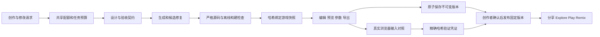

# ARCANE 第一轮优化交付

2026-10-10。基于完整代码审查后的优化路线实施，定位是可编辑、可导出的 HTML5 游戏创作平台。当前完成可靠性、生成验证、项目版本与分享发布的主要链路，并搭建稳定运行工具、参数编辑和评测底座。素材生产、真实模型质量跑分、生产环境联调以及后续 3D／多人／世界模型阶段仍需继续实施。

原始审查覆盖、逐模块问题和竞品来源见 [项目审查与优化路线](../audit-2026-10-09/ARCANE-项目审查与优化路线.md) 与 [阅读覆盖记录](../audit-2026-10-09/阅读覆盖记录.json)。审查覆盖 147 个主要代码、测试和示例文件，共 22,341 行；包括文档配置共 175 个文件、24,038 行。第三方依赖、临时克隆与生成输出不计入逐行覆盖。

**产品行为已经改变**

| 环节 | 本轮结果 | 验证边界 |
| --- | --- | --- |
| 生成与修改 | 严格文件与产物校验；修复围绕当前候选；精确哈希绑定原子修改；真实阶段事件、停止与旧任务隔离 | 使用 mock 模型验证编排；未测真实模型生成成功率 |
| 编辑与导出 | 当前工作区为唯一快照；编辑、预览、JSON、ZIP 和本地恢复使用同一份源码 | 实际浏览器验证文件内容及导出一致性 |
| 项目保存 | 不可变完整版本、事务提交、乐观版本冲突、幂等请求、上传失败补偿登记 | 单元测试已过；实际 MySQL／对象存储联调待执行 |
| 历史与恢复 | 分页元数据、按需加载；历史预览不覆盖当前脏稿；恢复后保存为新版本 | 测过失败保存、延迟响应和 A/B 项目隔离 |
| 试玩验证 | 独立浏览器进程，两种视口、两个种子、虚拟时钟和真实输入对照 | 技术检查不等于全部玩法规则成立 |
| 发布 | 精确版本与哈希凭证；创作者确认玩法后才能发布 | API 编排与实际 UI 已测；外部服务联调待执行 |
| 分享与探索 | private／unlisted／public；可撤销分享 token；Explore、Play、Remix | 来源项目不向访问者开放其他版本 |
| Remix | 派生项目保存 sourcePublicationId；新标题、新哈希、重新验证 | 源发布撤销或删除仍保留来源标识 |
| 参数 | 数字、颜色、开关参数；严格范围校验；变更重启预览 | AST 检测支持的引用形式；具体游戏参数效果仍需试玩确认 |

**关键工程改动**

- [artifact.ts](../../shared/game/artifact.ts) 统一安全路径、大小和文件校验；最多 40 文件、每文件 400 KB、总计 3 MB UTF-8 内容。SHA-256 覆盖元数据和全部源码，文件展示顺序不影响哈希。
- [bundle.ts](../../shared/game/bundle.ts) 使用 HTML 与 JavaScript 解析器处理入口和依赖，支持本地 JS 模块、CSS、SVG、JSON、静态导入及字面量动态导入。拒绝外部依赖、缺失引用与暂不支持的循环；保留经典脚本加载语义，ZIP 增加离线试玩入口。它尚不是任意 npm／TypeScript 工程构建器，也没有完整二进制资产机制。
- [freegen.ts](../../server/game/freegen.ts) 拒绝截断／非法 JSON；预算在模型调用前预留，规划、生成、JSON 重试与修复共享默认 64,000 tokens。没有 usage 时按保守上界记账；生成关闭底层自动 POST 重试。SSE 和 tRPC 共用限额，断线与 deadline 传到模型请求。
- [design.ts](../../shared/game/design.ts) 保存原始需求、回答、显式数量、控制、创作默认项与修改要求。服务端维护 arcane.design.json；这些记录帮助验收，不能代替证明模型实现正确。
- [browserRuntime.ts](../../shared/game/browserRuntime.ts) 提供可选生命周期、输入、缩放、HUD 和清理工具；保护该文件不被模型补丁覆写。仍保留自由创作，不强制所有游戏使用同一种模板。
- [browserQa.ts](../../server/game/browserQa.ts) 与 [browserQaWorker.ts](../../server/game/browserQaWorker.ts) 将游戏执行移入无业务密钥的子进程，限制并发、堆与时长，清理整个自有进程树。实际输入与无输入对照使用独立上下文和虚拟时钟，避免相互推进动画。DOM／绘制变化需要可见像素证据；纯动画、原生焦点、隐藏或全遮挡节点变化和默认滚动均有反例回归。它仍是有限输入检查，不能证明任意游戏的全部行为正确。
- [versionPersistence.ts](../../server/versionPersistence.ts) 与 [db.ts](../../server/db.ts) 将完整版本保存、父项目锁、版本分配、幂等与补偿统一；读取校验 manifest、文件哈希和整个 artifact，并限制读取并发和时长。
- [access.ts](../../server/game/access.ts)、私有对象 ACL、签名验证凭证及发布访问控制补齐权限与资源上限。计数器仍为单进程内存实现，不能作为多副本持久计费系统。
- [validationAccess.ts](../../server/game/validationAccess.ts) 单独限制浏览器验证：默认每用户每天 60 次、1 个并行任务，全局每天 400 次、2 个并行任务。它不占用模型生成次数和 token 预留；取消仍释放并发，服务关闭后拒绝新任务。
- Readiness 在数据库探测完成后重新读取停机状态；认证期间已经断开的请求不会随后启动模型、浏览器或版本保存任务。针对两类准入停机与已发生断线补充 5 条回归。
- 本地 Monaco ESM 和 workers 按需加载，替换 Markdown 的重依赖入口。最终主入口约 955.50 KB，gzip 283.94 KB；审查时为 1,471.56 KB、gzip 448.50 KB，gzip 下降约 36.7%。Monaco 延迟块仍约 3.98 MB、gzip 1.03 MB；这些是产物体积，不是实测首屏时间。
- 修复 Journey 引擎和当前源码示例、任务与隐藏事件条件，修复旧 Phaser 模板结束／重开／障碍行为，相关行为回归纳入测试。

**检查结果与证据**

最终统一检查的机器记录见 [verification.json](verification.json)。包括类型检查、完整测试、生产构建、真实浏览器基础能力、最终生产网页回归，以及仅安装生产依赖的服务导入和浏览器验证。

完整测试 **192 通过、4 跳过**；类型检查和前后端生产构建通过。编译后的 QA worker 在仅安装生产依赖、没有 Vite 的环境中跑完 **16 个案例**：15 个实际浏览器案例完成 **60 组输入检查**，另 1 个语法错误案例在构建阶段被阻断。每组单独断言正例与反例结果；这些数字代表验证框架回归覆盖，不代表模型生成游戏的合格率。服务导入与 health HTTP 检查使用 NODE_ENV=test，验证生产依赖完整性，未启动需要真实配置的生产服务。

实际浏览器工作台检查覆盖编辑后预览、ZIP 与源码一致性、重新加载后的草稿恢复、停止／新建游戏后的过期响应、历史与伪造 postMessage、手机布局及按钮真实点击反馈。项目流程检查覆盖 A/B 脏稿隔离、失败与延迟保存、旧生成任务、历史恢复失败、参数的实际效果与范围、发布门槛、Explore／Play／Remix 和撤销。模型、认证和持久化 API 在这些 UI 检查中被替换为受控响应，不能把它们说成真实外部服务联调。

浏览器证据：[项目流程记录](project-flow-smoke.json)、[QA 用例记录](qa-smoke-results.json)、[桌面工作台](workspace-desktop.png)、[手机工作台](workspace-mobile.png)、[发布界面](project-publish.png)。

新增 [CI](../../.github/workflows/ci.yml) 配置临时 MySQL 8 的迁移与集成测试、类型检查、完整测试、生产构建、Chromium 安装及浏览器回归。本轮本地没有运行远程 CI，4 条实际 MySQL 集成测试仍明确跳过。没有连接业务数据库、执行其 migration、写入外部存储、部署或调用计费模型。

**数据库与运行方式**

数据库变更保存在 [drizzle](../../drizzle/schema.ts)，包括恢复缺失的初始 users migration、版本完整性／幂等状态、发布与分享、清理队列和 [Remix 来源迁移](../../drizzle/0005_fine_aqueduct.sql)。Readiness 检查必要表与新字段，旧库缺 migration 会拒绝生产启动。

本地使用 Node.js 22.12+、pnpm 10.4.1。完整配置、迁移与部署说明见 [README](../../README.md) 和 [.env.example](../../.env.example)。常用检查为 pnpm check、pnpm test、pnpm build、pnpm qa:smoke；生产网页检查为 node tools/browser-smoke-suite.mjs。评测默认只读取已有游戏，真实模型模式必须显式启用并提供预算。

对象存储删除适配器尚未接入实际部署；失败上传记录会保留在 storage_cleanup，配置删除服务后可用 cleanup:storage 处理。生产 QA 还需要独立低权限运行环境、OS 级出口隔离及 CPU／内存限制；当前子进程、CSP 和浏览器请求拦截不能覆盖所有浏览器网络通道，亦不能替代 OS 沙箱。

**对标方向与后续实施顺序**

| 参照平台 | 本轮落地 | 下一步差距 |
| --- | --- | --- |
| [Google Playground](https://blog.google/innovation-and-ai/technology/ai/playground-experimental-gaming-platform/) | 创作→试玩→修改→固定版本发布→分享／Remix 的主要流程 | 尚无真实用户和真实模型数据；资产质量、作品发现与运行规模仍待建设 |
| [Roblox Build 评测框架](https://about.roblox.com/newsroom/2026/10/how-roblox-evaluates-build-game-creation) | 分开记录需求、工程、真实输入、视觉与人工验收；固定 30 个中文请求 | 逐玩法的数量、胜负、重开与稳定性自动场景；成本、延迟与合格率实测 |
| [GDevelop](https://gdevelop.io/features) | 稳定运行工具和支持的参数编辑 | 可复用行为组件、可视化事件／场景编辑及成熟导出工作流 |
| [Rosebud](https://rosebud.ai/ai-game-creator)、[Scenario](https://www.scenario.com/) | 可编辑代码和作品再创作 | 素材生成／上传、风格一致性、版权与来源、缓存、预算和资产 manifest |
| [Project Genie](https://blog.google/innovation-and-ai/models-and-research/google-deepmind/project-genie/)、[Unity Spark](https://unity.com/spark) | 保留未来扩展方向 | 真正 3D／多人／世界模型实验尚未实施；不能按研究或 Coming Soon 宣传视为已有能力 |

对标依据沿用 2026-10-09 审查时核实的官方资料，未进入竞品账户做同题实测，也没有声称 ARCANE 已达到竞品质量或规模。

后续应按依赖推进：先在独立 staging 联调 OAuth、空库／升级迁移、对象签名与清理、浏览器 worker 沙箱；随后跑 [30 项固定评测](../../evals/game-prompts.json)，补逐游戏验收场景，测出真实合格率、延迟、修复成本和回归率。再依据失败分布建设素材链路与可复用行为组件，完善持久任务、共享限额、账本、内容管理与作品发现。3D、多人与世界模型保留为后续独立实验，避免将尚未验证的能力计入本轮交付。

**本地恢复与版本基线**

工作区原先没有 Git 仓库。本轮交付建立当前已验证实现的本地版本基线，不连接远程、不推送。早期恢复归档（仅保存在本机，不随仓库发布） 保存于本机且排除凭据与依赖；归档创建时部分代理已开始修改，因此它不是实施前逐字不变的原始快照，不能据此宣称拥有全部变更的 pristine diff。凭据、运行日志、临时目录与第三方依赖均不纳入版本基线。
